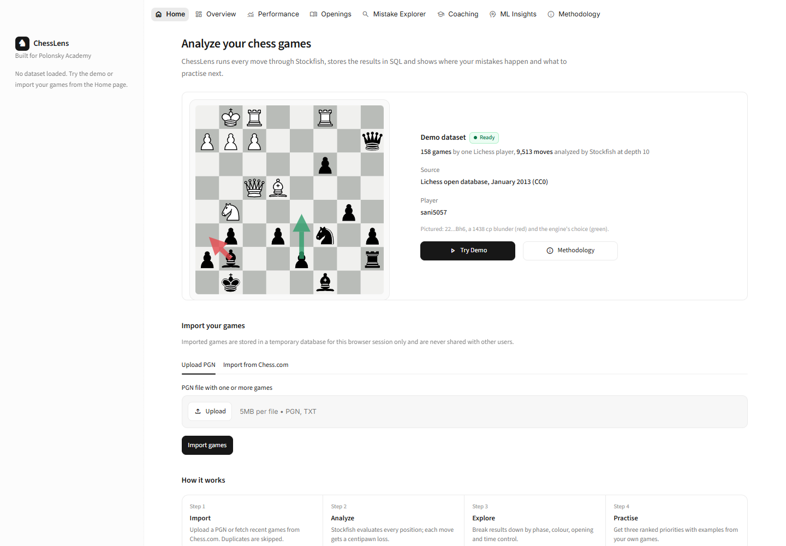
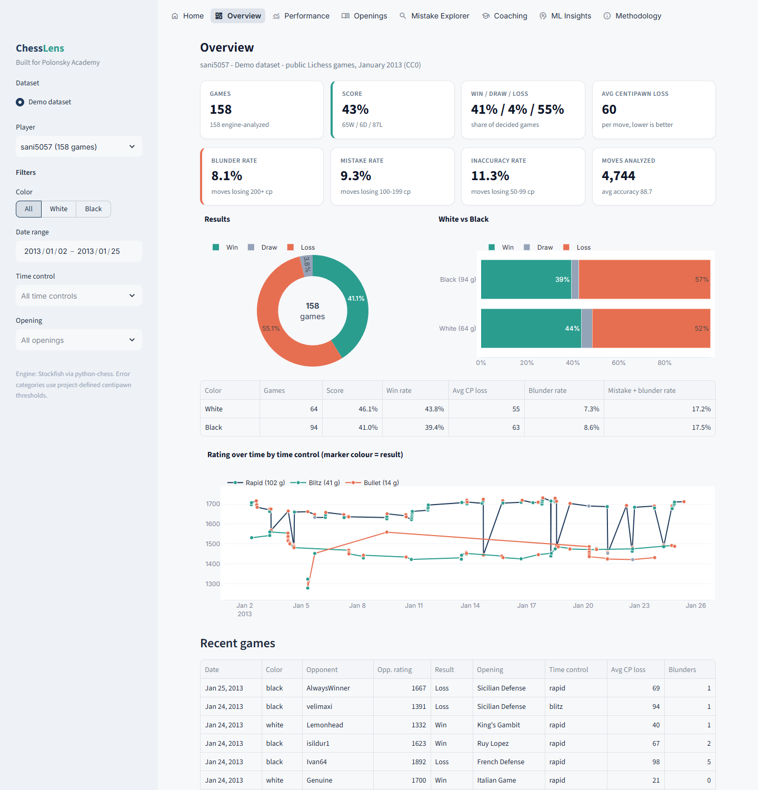
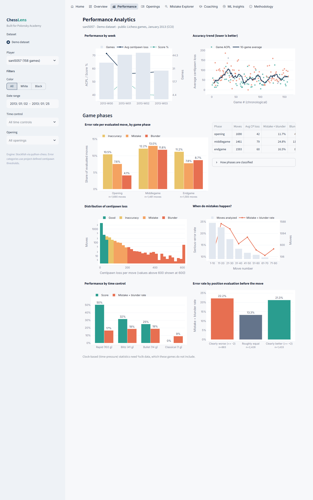
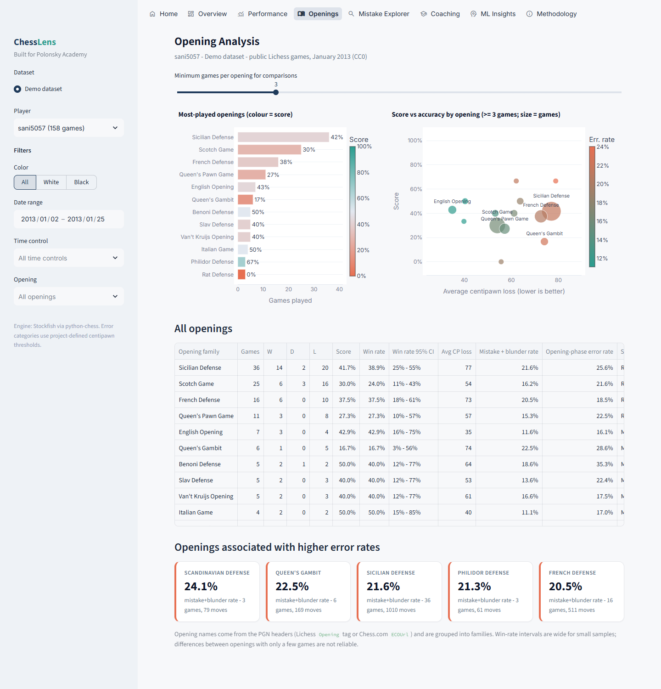
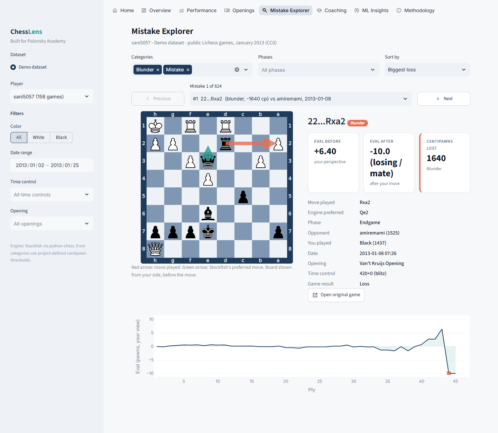
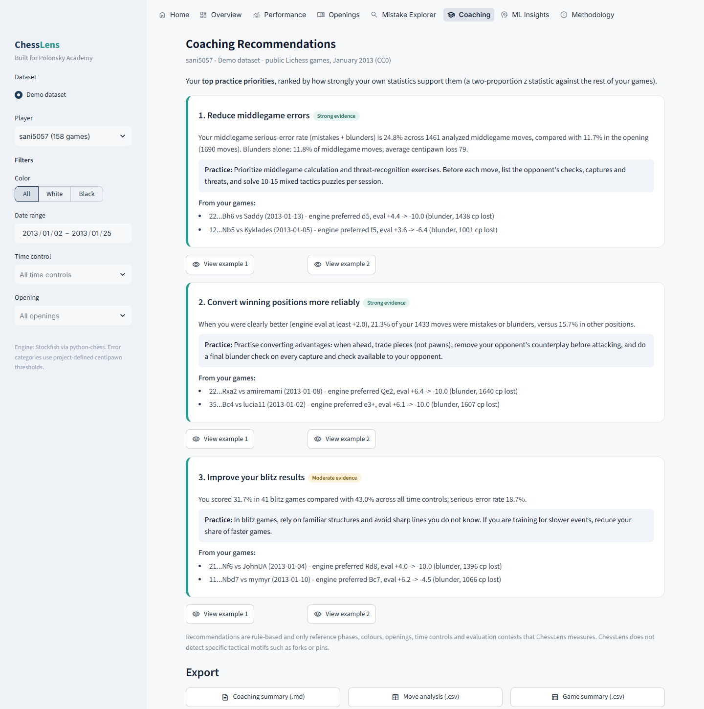
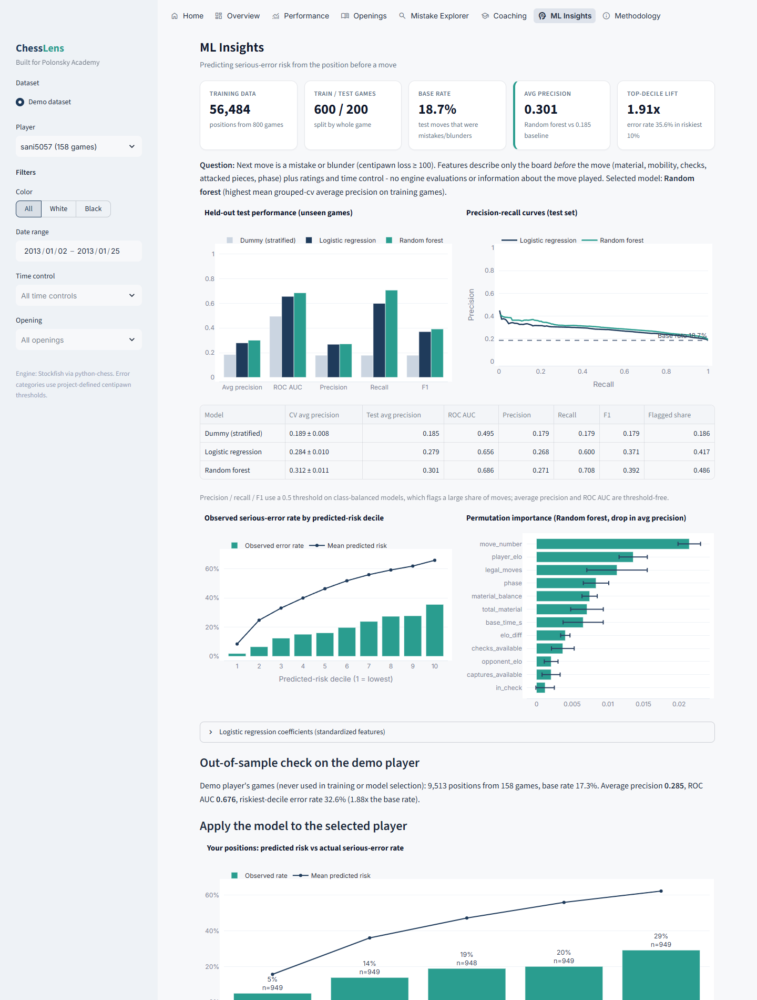
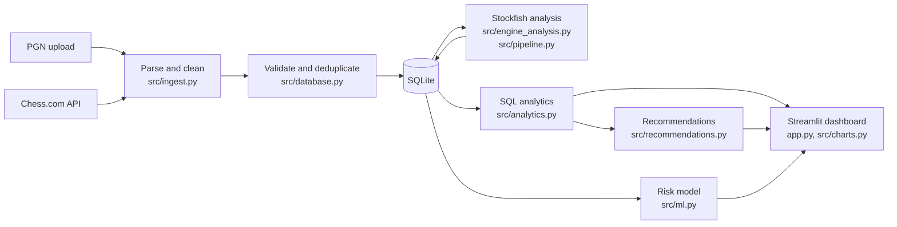

# ChessLens

**Stockfish-powered chess analytics: find where your games go wrong and what to practise next.**

ChessLens imports your games (PGN upload or the public Chess.com API), runs every position through
Stockfish, stores the results in a normalized SQLite database and turns them into an interactive
Streamlit dashboard: performance by phase, colour and time control, opening statistics with sample
sizes, a move-by-move mistake explorer, ranked coaching recommendations and an experimental
machine-learning model that estimates the risk of a serious mistake in a position.

*Built for Polonsky Academy.*



---

## Contents

- [Features](#features)
- [Screenshots](#screenshots)
- [Tech stack](#tech-stack)
- [Architecture](#architecture)
- [Demo dataset](#demo-dataset)
- [Analysis methodology](#analysis-methodology)
- [Machine-learning model](#machine-learning-model)
- [Run locally](#run-locally)
- [Deploy to Streamlit Community Cloud](#deploy-to-streamlit-community-cloud)
- [Testing](#testing)
- [Privacy and public-deployment limits](#privacy-and-public-deployment-limits)
- [Limitations](#limitations)
- [Future work](#future-work)

## Features

**Game import**
- **PGN upload:** multi-game files up to 5 MB / 500 games. ChessLens extracts the players, ratings,
  dates, time control, opening and clock comments, suggests which player to analyse, and skips
  malformed or non-standard-variant games while reporting why.
- **Chess.com import:** enter a username to fetch the most recent games (25 by default, at most
  100) from the public API. Requests use timeouts and a descriptive User-Agent, and retry `429` or
  `5xx` responses, honouring `Retry-After` with backoff.
- **Try Demo:** one click loads 158 public Lichess games that were analysed in advance (see
  [Demo dataset](#demo-dataset)).
- **Duplicate handling:** re-importing the same game is detected through a content hash and skipped.

**Stockfish analysis**
- Every position is evaluated, and centipawn loss is computed from the mover's perspective. Mate
  scores are mapped to ±10,000 cp and clamped to ±1,000 cp.
- Depth is configurable (6–14, default 10). Evaluations are cached per position and depth, so
  repeated positions such as common opening moves are evaluated only once.
- Analysis runs in a background thread with a live progress bar and a cancel button, so the
  dashboard stays usable. A per-run game cap and a server-wide limit on simultaneous engine jobs
  protect a shared deployment.
- Works on Windows, Linux and macOS. The engine is found through `STOCKFISH_PATH`, the system
  `PATH`, common install locations, or the project's `bin/` folder.

**Dashboard**
- **Overview:** record, score, average centipawn loss, error rates, rating trend and results by colour.
- **Performance:** error rates by phase and colour, centipawn-loss distribution, errors by move
  number, time-control comparison, results after winning or losing positions, time-pressure
  statistics (when the PGN contains clock data) and trends over time. Filters apply to every page:
  colour, date range, time control and opening.
- **Openings:** games, score, win rate with a 95% Wilson interval, average centipawn loss and
  opening-phase error rate per opening family. Small samples are flagged.
- **Mistake Explorer:** browse every inaccuracy, mistake and blunder on an SVG board with arrows
  for the played move (red) and the engine's best move (green), plus the evaluation curve of the
  game and a link to the original game.
- **Coaching:** the top three practice priorities ranked by statistical evidence, each with the
  supporting numbers, concrete advice and real example positions from your games. Exports include
  a Markdown coaching summary, move-level CSV and game-level CSV.
- **ML Insights:** model comparison against a baseline, precision-recall curves, calibration,
  feature importance and the model's risk estimates applied to the selected player.
- **Methodology:** every threshold, formula and limitation used in the app, documented in the app itself.

## Screenshots

All screenshots show the real demo dataset, captured from the running app with
`scripts/take_screenshots.py`.

| Overview | Performance |
| --- | --- |
|  |  |

| Openings | Mistake Explorer |
| --- | --- |
|  |  |

| Coaching | ML Insights |
| --- | --- |
|  |  |

## Tech stack

| Area | Tools |
| --- | --- |
| Language | Python 3.12 |
| App / UI | Streamlit (multipage navigation, fragments, background threads) |
| Chess | python-chess (PGN parsing, board logic, SVG boards), Stockfish 19 locally / Debian `stockfish` on the cloud |
| Data | SQLite (normalized schema, views, CTE-based analytics), Pandas, NumPy |
| Visualization | Plotly |
| Machine learning | scikit-learn (logistic regression, random forest, grouped cross-validation), joblib |
| Testing | pytest, Streamlit `AppTest`, Playwright browser smoke test |

## Architecture



```
app.py                     Streamlit entry point (pages, sidebar, import and analysis flows)
src/config.py              Paths, thresholds and environment-overridable limits
src/ingest.py              PGN parsing/cleaning, metadata extraction, Chess.com client
src/features.py            Board features (phase, material, mobility, vulnerable pieces) and ML frame
src/engine_analysis.py     Stockfish wrapper, centipawn loss, classification, accuracy
src/database.py            SQLite schema, inserts, deduplication, evaluation cache
src/pipeline.py            Import -> store -> analyse orchestration, background analysis job
src/analytics.py           SQL analytics queries, Wilson interval, two-proportion z-test
src/recommendations.py     Rule-based coaching recommendations ranked by z statistic
src/ml.py                  Serious-mistake risk model: training, evaluation, inference
src/charts.py, src/ui.py   Plotly charts, board rendering and styling
src/reporting.py           CSV export and Markdown coaching summary
scripts/                   Demo/model build, Stockfish installer, screenshots, UI smoke test
tests/                     pytest suite
data/demo/demo.db          Pre-analysed demo database (opened read-only)
data/models/               Trained model, metrics and training frame
```

**Database schema.** `players`, `games` (metadata plus a unique content hash), `moves` (one row
per ply with the position before the move and pre-move board features), `move_analysis`
(evaluations, best move, centipawn loss, classification, accuracy), `position_evals` (engine cache
keyed by position and depth) and `analysis_runs`. The view `v_player_games` presents every game
from each player's perspective (colour, own and opponent rating, score), which keeps the analytics
queries simple: they are composed from common table expressions over this view.

## Demo dataset

The demo uses **real public games** from the
[Lichess open database](https://database.lichess.org/), file
`lichess_db_standard_rated_2013-01.pgn.zst` (January 2013 standard rated games), which Lichess
releases under **CC0 (public domain)**. No private or student data is included.

- **Demo player:** the Lichess user `sani5057`, chosen with documented criteria: 60–160 games in
  the month, an average rating of roughly 1350–1850 and a mix of time controls, so that every
  dashboard section has enough data. The demo contains **158 games** played between 2 and
  25 January 2013 (ratings 1278–1731, average 1584): 102 rapid, 41 blitz, 14 bullet and 1 classical.
- **Analysis:** all 9,513 plies of these games were analysed with Stockfish at depth 10.
- **ML corpus:** 800 other games from the same file, sampled at random (seed 42) from games where
  both players have a rating, the time control is known, the demo player is not involved and the
  game lasts at least about 15 moves.
- The 2013 files contain no clock comments, so time-pressure statistics are hidden for the demo.
  They appear for PGNs or Chess.com games that include clock data.

To rebuild everything from the source file:

```bash
python scripts/prepare_demo.py            # downloads ~17 MB, builds demo.db, the corpus and the model
python scripts/prepare_demo.py --help     # options: --player, --depth, --corpus-games, --workers, --seed ...
```

## Analysis methodology

**Centipawn loss (CPL).** For each move, Stockfish evaluates the position before and after it.
Scores are converted to centipawns from the moving side's point of view, with mates mapped to
±10,000 and every evaluation clamped to ±1,000 cp. Then
`CPL = max(0, eval_before − eval_after)`. If the played move is the engine's best move, its CPL is 0.
Checkmate and stalemate positions are scored exactly, without an engine call.

**Move classification.** The thresholds below are **project-defined conventions**, similar to
those used by popular sites but not an official standard:

| CPL | Category |
| --- | --- |
| < 50 | Good |
| 50–99 | Inaccuracy |
| 100–199 | Mistake |
| ≥ 200 | Blunder |

A **serious error** is a mistake or a blunder (CPL ≥ 100).

**Accuracy and win probability** use the published Lichess formulas:
`win% = 50 + 50 · (2 / (1 + e^(−0.00368208 · cp)) − 1)` and
`accuracy = 103.1668 · e^(−0.04354 · (win%_before − win%_after)) − 3.1669`, clipped to 0–100.

**Game phase** is a heuristic based on the material left on the board:
- *Endgame:* 6 or fewer queens, rooks, bishops and knights remain in total.
- *Opening:* move number is 12 or lower and at least 11 such pieces remain.
- *Middlegame:* every other position.

**Statistics.**
- Opening win rates include **95% Wilson score intervals**.
- Openings with fewer than 3 games are flagged as small samples.
- Phase comparisons require at least 30 moves.

**Coaching recommendations** are generated by rules, not by a language model. Each candidate
weakness is compared with the rest of the player's games using a **two-proportion z statistic**
(for error rates) or a score-difference z statistic (for results). Candidates are ranked by z, and
the top three are shown with their sample sizes, a confidence label (Strong for z ≥ 2.5, Moderate
for z ≥ 1.5, otherwise Tentative) and example positions. The candidate weaknesses are:
- the weakest game phase;
- colour;
- an opening with at least 5 games;
- converting winning positions;
- errors under time pressure;
- errors late in the game;
- a time control.

**What ChessLens does not do.** It does not detect tactical motifs such as forks, pins or skewers.
Recommendations refer only to quantities that are actually measured: phase, colour, opening,
evaluation context, clock and time control.

## Machine-learning model

**Question:** given only information available *before* a move is played, how likely is the player
to make a serious error (CPL ≥ 100) in this position?

- **Features (pre-move only):**
  - move number;
  - player and opponent rating, rating difference and a missing-rating flag;
  - colour;
  - game phase;
  - material balance and total material;
  - number of legal moves;
  - in check;
  - counts of vulnerable own and opponent pieces (attacked and either undefended or attacked by a
    cheaper piece; a static heuristic, not a tactic detector);
  - available captures and checks;
  - base time and increment.

  Engine outputs and the played move (`cpl`, evaluations, best move, SAN/UCI, accuracy) are
  explicitly blocked by a leakage check.
- **Data:** 56,484 positions from the 800-game corpus at depth 10. Positives make up about 18–19%
  of positions.
- **Split:** `GroupShuffleSplit` **by game**: 600 games (42,264 positions) for training and
  200 games (14,220 positions) for testing. A position's game never appears in both sets.
  Model selection uses 5-fold `GroupKFold` cross-validation on the training games.
- **Models:** a stratified dummy baseline, logistic regression (`class_weight="balanced"`) and a
  random forest (`class_weight="balanced_subsample"`). Class imbalance is handled through class
  weights, and models are compared by average precision rather than accuracy.

**Results on the held-out test games** (test base rate 18.7%; threshold 0.5 on balanced-weight models):

| Model | CV avg. precision | Test avg. precision | ROC AUC | Precision | Recall | F1 | Top-decile lift |
| --- | --- | --- | --- | --- | --- | --- | --- |
| Dummy (stratified) | 0.189 ± 0.008 | 0.185 | 0.495 | 0.179 | 0.179 | 0.179 | 0.99× |
| Logistic regression | 0.284 ± 0.010 | 0.279 | 0.656 | 0.268 | 0.600 | 0.371 | 1.70× |
| **Random forest** (selected) | 0.312 ± 0.011 | 0.301 | 0.686 | 0.271 | 0.708 | 0.392 | 1.91× |

**External check:** on the demo player's 9,513 positions, which are not in the corpus (base rate
17.3%), the random forest scored AP 0.285, ROC AUC 0.676 and a top-decile lift of 1.88×.

**Interpretation.** The model is clearly better than the baseline but **weak in absolute terms**.
- *What it can do:* rank positions by risk. The 10% of test positions it rates riskiest contain
  serious errors at about 1.9 times the base rate.
- *What it cannot do:* predict individual mistakes reliably.
- *Calibration:* because of the balanced class weights, raw probabilities are inflated. In the top
  decile the mean prediction is 0.66 against an observed rate of 0.36. The app therefore presents
  relative risk rather than literal probabilities.
- *Most important features* (permutation importance): move number, player rating, then the number
  of legal moves.

**Model limitations:**
- Labels come from a shallow depth-10 search.
- The 100 cp threshold is a project convention.
- All training data is from one month in 2013, with no clock data.
- Features are coarse static descriptors and do not capture concrete tactics.
- Results are associations, not causes.

Retrain with `python scripts/prepare_demo.py --skip-demo`.

## Run locally

Requires Python 3.12. The commands below are for Windows PowerShell; on macOS or Linux, use
`source .venv/bin/activate` instead of the second line.

```powershell
git clone <your-repo-url> ChessLens
cd ChessLens
python -m venv .venv
.\.venv\Scripts\Activate.ps1
pip install -r requirements.txt

# Stockfish: either install it yourself (and put it on PATH or set STOCKFISH_PATH),
# or download the official Stockfish 19 build for your OS into ./bin:
python scripts/install_stockfish.py

streamlit run app.py
```

Then open <http://localhost:8501> and click **Try Demo**, or import your own games.

**Configuration** (optional environment variables):

| Variable | Default | Meaning |
| --- | --- | --- |
| `STOCKFISH_PATH` | auto-detect | Path to the Stockfish binary |
| `CHESSLENS_MAX_DEPTH` | 14 | Highest depth the slider allows |
| `CHESSLENS_MAX_ANALYSIS_GAMES` | 40 | Games per analysis run |
| `CHESSLENS_MAX_UPLOAD_GAMES` | 500 | Games read from one PGN |
| `CHESSLENS_MAX_CONCURRENT_ANALYSES` | 2 | Simultaneous engine jobs per server |
| `CHESSLENS_ENGINE_THREADS` / `CHESSLENS_ENGINE_HASH_MB` | 1 / 64 | Stockfish resources per job |

## Deploy to Streamlit Community Cloud

The repository is ready for [Streamlit Community Cloud](https://share.streamlit.io):
- `requirements.txt` pins the Python dependencies.
- `packages.txt` installs the Debian `stockfish` package, which ChessLens finds automatically at
  `/usr/games/stockfish`.
- `.streamlit/config.toml` sets the theme and the 5 MB upload limit.
- The demo database and trained model are committed.
- No secrets are required.

Steps:

1. Create an empty GitHub repository and push this project to it.
   ```bash
   git remote add origin https://github.com/<you>/chesslens.git
   git push -u origin main
   ```
2. Sign in at <https://share.streamlit.io> with GitHub and choose **Create app**, then
   **Deploy a public app from GitHub**.
3. Select the repository, branch `main` and main file `app.py`.
4. Under **Advanced settings**, choose **Python 3.12**. Optionally add any of the configuration
   variables above as top-level secrets, which Streamlit exposes as environment variables.
5. Click **Deploy**.

The cloud build uses Debian's Stockfish package, which is an older version than the Stockfish 19
used to build the demo locally. Its evaluations of user-uploaded games can therefore differ
slightly from a local run. The demo itself is unaffected because it is pre-analysed.

## Testing

```bash
pip install -r requirements-dev.txt
pytest                                   # 87 tests
```

The suite covers the following areas; the end-to-end tests are skipped automatically if Stockfish
is not installed:
- PGN parsing, cleaning and malformed input;
- metadata and time-control classification;
- the Chess.com client (with a mocked HTTP session: retries, 404s, timeouts and the game cap);
- centipawn-loss maths from both colours' perspectives, mate handling and classification
  boundaries;
- the real-engine mate-in-one check and the evaluation cache;
- SQL analytics against hand-computed values, deduplication and read-only demo access;
- features and leakage checks, the grouped split and the training pipeline;
- recommendation ranking and reports;
- an end-to-end import, analyse and query run;
- the background job and its engine-slot queue;
- Streamlit `AppTest` renders of every page.

A browser-level smoke test drives the running app with Playwright. It loads every demo page,
uploads a PGN, runs the analysis, re-uploads the file to check duplicate detection and optionally
imports from Chess.com:

```bash
python -m playwright install msedge      # or use any installed Chromium channel
streamlit run app.py                     # in another terminal
python scripts/ui_smoke_test.py [--chesscom USERNAME]
```

## Privacy and public-deployment limits

- **Each browser session gets its own private SQLite file**, stored in the system temp directory
  under a random UUID. No user can query another session's data. Session files are deleted after
  12 hours.
- **The demo database is opened read-only** and is never mixed with uploaded data.
- **The app stores no API keys or credentials.** The Chess.com endpoints are public and need no key.
- **Resource limits for public use:**
  - uploads: 5 MB and 500 games;
  - analysis: 40 games per run and depth 14 at most;
  - engine: one thread and 64 MB of hash per job;
  - concurrency: two simultaneous engine jobs per server (further jobs queue).

## Limitations

- **Data is per session.** Refreshing the browser starts a new session, so uploaded games must be
  imported again. There are no user accounts.
- **Shallow analysis.** Depth 10 is fast but imperfect; some "errors" at this depth are engine noise.
- **Thresholds and phase boundaries are heuristics** chosen for this project.
- **No tactical motif detection** (forks, pins, and so on), and no opening theory beyond the PGN's
  opening name.
- **Opening statistics need many games;** most opening differences in a few dozen games are not
  statistically meaningful, which the app shows through intervals and sample-size flags.
- **The ML model is modest** (see above) and was trained on 2013 Lichess data.
- **Chess.com import** depends on the public API's availability and rate limits. Only standard
  chess games are imported; variants are skipped.

## Future work

- Persistent accounts (for example, authentication plus a hosted database) so that analyses survive refreshes.
- Implemented tactic detectors (hanging pieces after the move, forks, pins) to make coaching more specific.
- Lichess API import and multi-PV analysis for "only move" detection.
- A richer ML feature set (clock, recent-error history) trained on recent games with clock data.

---

*ChessLens was built for Polonsky Academy. Chess data in the demo comes from the Lichess open
database (CC0). Stockfish is GPL-licensed and is used as a separate executable.*
